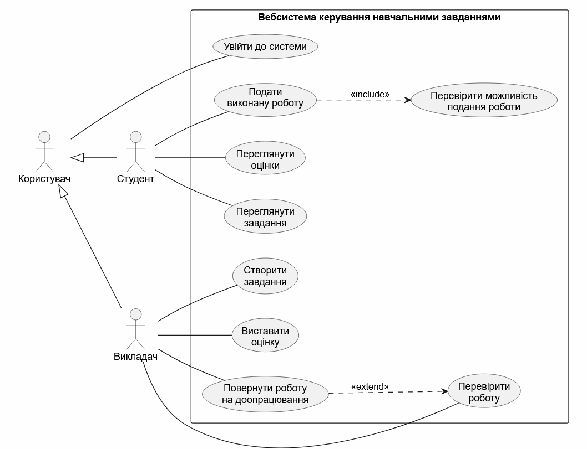
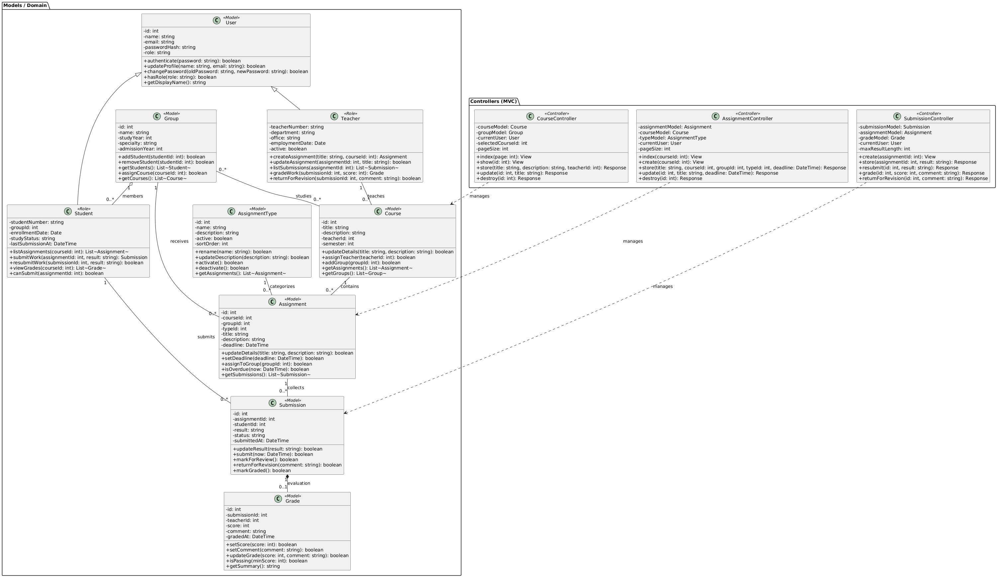

# Вебсистема керування навчальними завданнями

## 1. Опис системи

Вебсистема керування навчальними завданнями призначена для організації взаємодії між викладачами та студентами. Вона дозволяє створювати навчальні завдання, призначати їх групам, подавати виконані роботи та перевіряти результати.

### Основні функції
- Керування навчальними предметами.
- Створення завдань із зазначенням типу та дедлайну.
- Призначення завдань навчальним групам.
- Перегляд завдань студентами.
- Подання результатів виконаних робіт.
- Перевірка та оцінювання робіт.
- Відстеження статусів виконання.

### Користувачі
- **Студент** — переглядає завдання, подає роботи та отримує результати перевірки.
- **Викладач** — створює завдання, перевіряє роботи, виставляє оцінки та повертає роботи на доопрацювання.

### Архітектура
Для реалізації системи обрано PHP/Laravel та архітектуру MVC:
- **Model** — робота з даними користувачів, предметів, завдань, робіт та оцінок.
- **View** — відображення вебсторінок за допомогою Blade.
- **Controller** — обробка запитів користувачів і взаємодія з моделями.

Основні сутності: User, Group, Course, AssignmentType, Assignment, Submission, Grade.

## 2. Повний Use Case — Подання виконаної роботи

**Основний актор:** Студент.

**Мета:** Передати результат виконаного навчального завдання для перевірки викладачем.

**Передумови:**
- Студент має зареєстрований обліковий запис.
- Студент належить до групи, якій призначено завдання.
- Завдання існує в системі та доступне студенту.

### Головний успішний сценарій

1. Студент входить до вебсистеми під своїм обліковим записом.
2. Система перевіряє дані авторизації та відкриває головну сторінку студента.
3. Студент переходить до розділу «Навчальні завдання».
4. Система відображає перелік завдань його групи.
5. Студент обирає завдання, результат виконання якого хоче подати.
6. Система відкриває сторінку завдання з описом, типом роботи та терміном виконання.
7. Студент натискає кнопку «Подати роботу».
8. Система перевіряє можливість подання та відкриває форму.
9. Студент додає результат виконаного завдання.
10. Студент натискає кнопку «Надіслати».
11. Система перевіряє правильність і повноту введених даних.
12. Система зберігає роботу та встановлює статус «На перевірці».
13. Система повідомляє про успішне подання.
14. Студент повертається до списку завдань і бачить оновлений статус.

### Альтернативні сценарії

**А1. Помилка авторизації (крок 2).** Система повідомляє про неправильні облікові дані та пропонує повторити вхід.

**А2. Відсутність доступу (крок 5).** Якщо завдання не призначене групі студента, система обмежує доступ.

**А3. Завершення терміну подання (крок 8).** Якщо дедлайн минув і пізнє подання заборонено, система не дозволяє здати роботу.

**А4. Не заповнено обов'язкові поля (крок 11).** Система повідомляє про помилку та пропонує заповнити необхідні поля.

**А5. Повторне подання (крок 8).** Якщо робота перебуває на перевірці або оцінена, повторне подання заборонене. Якщо викладач повернув її на доопрацювання, студент може подати виправлений результат.

**Післяумови:** Робота збережена, отримала статус «На перевірці» та доступна викладачу.

## 3. UML-діаграма варіантів використання

Вихідний код: [use-case-diagram.puml](use-case-diagram.puml).

## 4. UML-діаграма класів

Вихідний код: [class-diagram-compact.puml](class-diagram-compact.puml).
